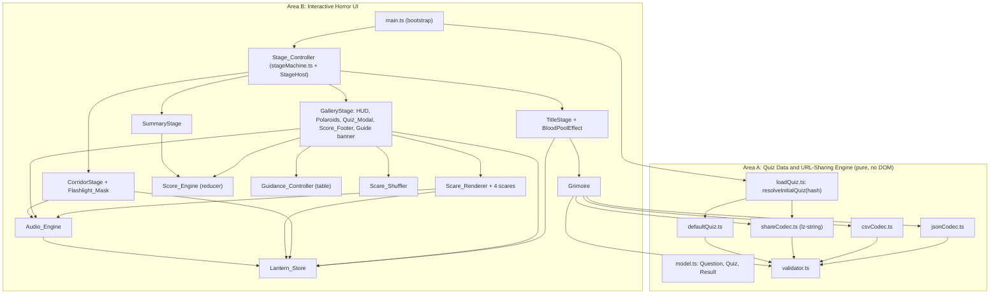
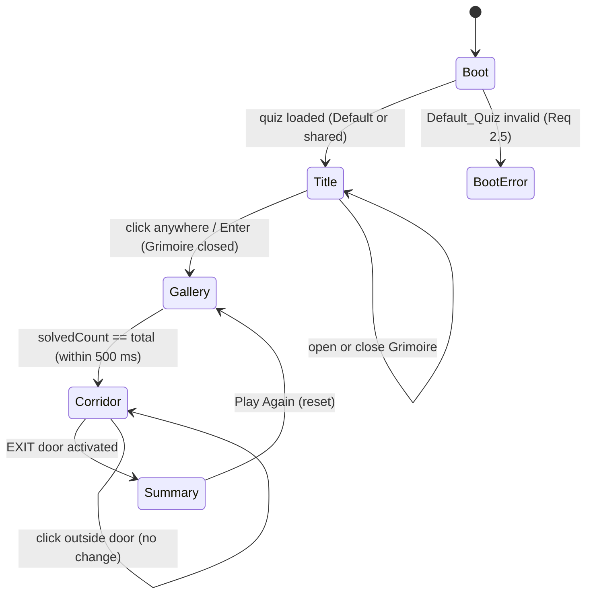
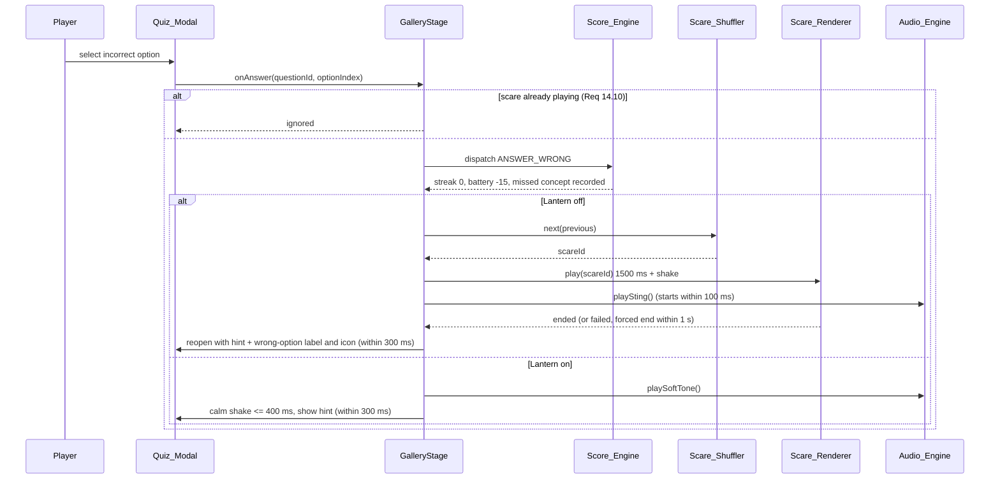

# Design Document: Horpang MVP

## Overview

Horpang is a client-only horror quiz game. Stage order is **Title -> Gallery -> Corridor -> Summary**. The player answers every Polaroid question in the Gallery, then searches a dark Corridor with a flashlight for the glowing EXIT door, then sees the Summary. Educators edit quizzes in The Grimoire and share them as a `lz-string` URL hash. There is no backend.

The design has two strictly separated areas.

- **Area A, Quiz Data and URL-Sharing Engine** (`src/engine/`). Pure, DOM-free TypeScript: question model, Validator, Default_Quiz, JSON_Codec, CSV_Codec, Share_Codec, hash-loading logic. Covers Requirements 1 to 6.
- **Area B, Interactive Horror UI** (`src/game/`, `src/ui/`, `src/audio/`). Stage_Controller, Blood_Canvas, Gallery (HUD, Polaroids, Quiz_Modal, Score_Footer), Corridor, Summary, Grimoire, Scare_Shuffler and Scare_Renderer, Guidance_Controller, Score_Engine, Audio_Engine, Lantern_Store. Covers Requirements 7 to 20.

Inside Area B, decision logic (Score_Engine, Guidance_Controller, Scare_Shuffler, stage transitions, Summary calculations, flashlight geometry) is also written as pure functions with no DOM access. The rendering layer calls them and paints the result. This is what makes the logic testable with Vitest and fast-check.

### Design decisions

| Decision | Rationale |
|---|---|
| Vanilla TypeScript modules, no UI framework | The UI is a handful of stages with imperative canvas, SVG and focus handling. A framework adds weight without removing the hard parts. Each stage is a class with `mount(root)` and `destroy()`. |
| One-way data flow: `dispatch(action) -> reducer -> state -> render` | Reducers stay pure. Rendering subscribes to state. Guidance, HUD, Score_Footer and Summary are all derived from the same state, so HUD score always equals footer score (Req 9.6). |
| Injectable `Rng` and `Clock` everywhere randomness or time appears | Needed for seeded Scare_Shuffler tests (Req 15.4) and deterministic Blood_Canvas tests. |
| Codecs return `Result<T, E>` values and never throw | Required by Req 6.3. |
| All art is generated inline SVG or CSS | Req 20. Only the Google Fonts stylesheet is external, with fallback stacks. |
| Corridor is entered only when all questions are solved | Req 8.1 and 16.1. Enforced in the stage transition function, not in the view. |

### Research summary

- **lz-string**: `compressToEncodedURIComponent` / `decompressFromEncodedURIComponent` produce output using only `A-Za-z0-9+-$`, which is legal in a URL fragment without percent-encoding. Decompression of garbage returns `null` or `""` instead of throwing, so both must be treated as failure. The library is deterministic, which gives the determinism property for free once JSON key order is fixed. Source: [pieroxy/lz-string](https://github.com/pieroxy/lz-string).
- **Pointer Events** unify mouse, touch and pen with one handler and expose `clientX/clientY`. Setting `touch-action: none` on the corridor stops the browser from scrolling during a drag. Source: [MDN Pointer events](https://developer.mozilla.org/en-US/docs/Web/API/Pointer_events).
- **Web Audio autoplay policy**: an `AudioContext` created before a user gesture starts `suspended`. Creating it inside the first gesture handler satisfies Req 18.2. Source: [MDN Autoplay guide](https://developer.mozilla.org/en-US/docs/Web/Media/Guides/Autoplay).
- **`prefers-reduced-motion`** is read with `matchMedia('(prefers-reduced-motion: reduce)')` (Req 19.4). Source: [MDN](https://developer.mozilla.org/en-US/docs/Web/CSS/@media/prefers-reduced-motion).
- **fast-check** supplies the property-based testing primitives and seeded runs, so no PBT machinery is written from scratch. Source: [fast-check docs](https://fast-check.dev/).

*Content was rephrased for compliance with licensing restrictions.*

## Architecture



Area B depends on Area A only through the public `engine/index.ts` barrel (types, `validateQuiz`, codecs, `resolveInitialQuiz`). Area A imports nothing from Area B and nothing from `window` or `document`.

### Stage state machine



The transition function is pure:

```ts
// src/game/stageMachine.ts
export type StageId = 'boot' | 'bootError' | 'title' | 'gallery' | 'corridor' | 'summary';
export type StageEvent =
  | { type: 'QUIZ_READY' } | { type: 'QUIZ_UNAVAILABLE' }
  | { type: 'ENTER_GALLERY'; grimoireOpen: boolean }
  | { type: 'SCORE_UPDATED'; solved: number; total: number }
  | { type: 'EXIT_ACTIVATED' } | { type: 'PLAY_AGAIN' };
export function nextStage(current: StageId, ev: StageEvent): StageId;
```

Rules: `ENTER_GALLERY` is ignored when `grimoireOpen` (Req 7.14). `SCORE_UPDATED` moves `gallery -> corridor` only when `total > 0 && solved === total`. `EXIT_ACTIVATED` is only valid in `corridor`. Any other pair returns `current`.

### Wrong-answer sequence



## Components and Interfaces

### Project layout (Vite + TypeScript strict + Tailwind)

```
horpang/
  index.html                 # Google Fonts <link> (the only external resource), #app root, live regions
  vite.config.ts             # Vitest config (environment: node; jsdom only for ui tests)
  tsconfig.json              # "strict": true, "noUncheckedIndexedAccess": true
  tailwind.config.ts         # palette tokens: black, bone, crimson, exit-green, grays
  src/
    main.ts                  # bootstrap: Lantern_Store, resolveInitialQuiz, Stage host
    styles/index.css         # Tailwind layers + keyframes (drip, pulse, shake, scares)
    engine/                  # AREA A (pure)
      model.ts  validator.ts  defaultQuiz.ts  jsonCodec.ts  csvCodec.ts
      shareCodec.ts  loadQuiz.ts  limits.ts  index.ts
    game/                    # AREA B pure logic (no DOM)
      stageMachine.ts  scoreEngine.ts  guidance.ts  scareShuffler.ts
      summary.ts  flashlight.ts  rng.ts  contrast.ts
    audio/
      audioEngine.ts  stings.ts      # graph builders take an AudioContext-like interface
    state/
      store.ts  lanternStore.ts
    ui/                      # AREA B rendering
      stageHost.ts  dom.ts  focusTrap.ts  liveRegion.ts
      title/ TitleStage.ts  BloodPoolEffect.ts  BloodDrip.ts
      gallery/ GalleryStage.ts  Hud.ts  Polaroid.ts  QuizModal.ts  ScoreFooter.ts  GuideBanner.ts
      photos/ cursedPhotos.ts       # generated SVG strings
      corridor/ CorridorStage.ts  stairwellSvg.ts  FlashlightMask.ts
      summary/ SummaryStage.ts
      grimoire/ Grimoire.ts  QuestionForm.ts
      scares/ ScareRenderer.ts  endoskeleton.ts  horpang.ts  crt.ts  glass.ts
  tests/
    engine/*.test.ts  game/*.test.ts  ui/*.test.ts  generators.ts
```

### Area A: Quiz Data and URL-Sharing Engine

```ts
// engine/model.ts
export interface Question {
  id: string; prompt: string; options: string[]; correctIndex: number;
  explanation: string; hint: string; concept: string;
}
export interface Quiz { title: string; questions: Question[]; }

export type Result<T, E> = { ok: true; value: T } | { ok: false; error: E };

export interface ValidationError {
  position: number | null;   // 1-based Question position, null = Quiz-level
  field: string;             // 'title','questions','id','prompt','options','options[2]','correctIndex',...
  message: string;
}
```

```ts
// engine/limits.ts
export const LIMITS = {
  promptMax: 300, optionMin: 2, optionMax: 6, optionLenMax: 120,
  explanationMax: 500, hintMax: 200, conceptMax: 50,
  questionsMin: 1, questionsMax: 30, titleMax: 80,
  fileMaxBytes: 1_048_576, hashMax: 8000,
} as const;
```

**Validator** (`validator.ts`)

```ts
export function validateQuestion(q: unknown, position: number): ValidationError[];
export function validateQuiz(quiz: unknown): ValidationError[];   // [] means valid
export function isValidQuiz(quiz: unknown): quiz is Quiz;
```

- Accepts `unknown`. Every field is type-checked first (Req 1.8). A missing or wrong-type field yields one error for that field and the remaining checks on that field are skipped. No exception escapes.
- "Empty" means `trim().length === 0`. Length limits use `string.length` of the original value.
- `correctIndex` must satisfy `Number.isInteger` and `0 <= i < options.length`.
- Duplicate ids: the first occurrence is fine, each later occurrence yields `{position, field:'id'}` (Req 1.7).
- Returns one error per failing field (Req 1.6). The input is never mutated or normalized.

**Default quiz** (`defaultQuiz.ts`): exports `DEFAULT_QUIZ: Quiz` with 5 to 20 questions (planned: 8) and `loadDefaultQuiz(): Result<Quiz, ValidationError[]>`, which validates before returning (Req 2.1, 2.2, 2.5).

**JSON_Codec** (`jsonCodec.ts`)

```ts
export type CodecError =
  | { kind: 'too-large'; bytes: number; limit: number }
  | { kind: 'empty' }
  | { kind: 'syntax'; message: string; line: number; column: number }
  | { kind: 'validation'; errors: ValidationError[] }
  | { kind: 'csv-missing-column'; column: string; row: number }
  | { kind: 'csv-unterminated-quote'; row: number };
export function parseQuizJson(text: string): Result<Quiz, CodecError[]>;
export function printQuizJson(quiz: Quiz): string;
```

- Size is checked first using the UTF-8 byte length (`new TextEncoder().encode(text).length`), before `JSON.parse` (Req 3.6). Empty or whitespace-only text returns `empty` (Req 3.7).
- On a `JSON.parse` `SyntaxError`, line and column are derived from the error position. Where the engine gives only a message, the helper `locate(text, pos)` computes them from the offset in the message, and falls back to scanning for the first position at which a prefix cannot be extended (line 1, column 1 as last resort).
- `printQuizJson` writes keys in a fixed order (`title`, `questions`; per question `id, prompt, options, correctIndex, explanation, hint, concept`) with 2-space indentation. Result is UTF-8-safe text.
- Parsing builds a `Quiz` by explicitly copying the known keys, so extra keys never break equality in the round trip.

**CSV_Codec** (`csvCodec.ts`)

```ts
export const CSV_HEADER = ['id','prompt','options','correctIndex','explanation','hint','concept'] as const;
export function parseQuizCsv(text: string, title?: string): Result<Quiz, CodecError[]>;
export function printQuizCsv(quiz: Quiz): string;
```

- One header row, one row per Question, columns in the order in Req 4.1.
- The CSV format has no place for a quiz title and Req 4.1 allows only a header row plus one row per Question. `printQuizCsv` therefore writes the header and one row per Question only. The quiz title is passed to `parseQuizCsv` as a second argument (the Grimoire supplies the current title; default `"Imported Quiz"`). The round-trip property for CSV is therefore stated over `parse(print(q), q.title)`.
- The `options` column holds the options as a JSON array string (for example `["a","b"]`), which keeps option text with commas, quotes and line breaks lossless. The CSV quoting layer then handles the outer escaping.
- Fields containing `,`, `"`, `\n` or `\r` are wrapped in double quotes with inner `"` doubled (Req 4.3). The parser is a small state machine (field start, unquoted, quoted, quote-in-quoted) that restores all of them (Req 4.4). Line endings `\r\n` and `\n` are both accepted. A trailing newline does not create an empty row.
- Missing columns: one error per missing header name with `row: 1` (Req 4.5). An unterminated quote returns the 1-based row where the quote began (Req 4.6).
- Validation errors from the Validator carry the 1-based Question position. The codec maps position `p` to row `p + 1` (header is row 1) and returns one entry per failing Question (Req 4.7).
- Size check before parsing (Req 4.9).

**Share_Codec** (`shareCodec.ts`)

```ts
export type ShareError =
  | { kind: 'empty' }
  | { kind: 'length-exceeded'; length: number; limit: 8000 }
  | { kind: 'decompression' }
  | { kind: 'invalid-json' }
  | { kind: 'malformed' }
  | { kind: 'validation'; errors: ValidationError[] };
export function encodeQuiz(quiz: Quiz): Result<string, ShareError>;
export function decodeShareHash(hash: string): Result<Quiz, ShareError>;
```

- `encodeQuiz`: `compressToEncodedURIComponent(printQuizJson(quiz))`. Output longer than 8000 returns `length-exceeded` with the actual length and no hash (Req 5.7). `printQuizJson` here uses compact (no indentation) JSON with the fixed key order, so encoding is deterministic (Req 5.6) and short.
- `decodeShareHash`: empty -> `empty` (no Validator call). Longer than 8000 -> `length-exceeded`. `decompressFromEncodedURIComponent` returning `null` or `""` -> `decompression`. `JSON.parse` failure -> `invalid-json`. Not an object with `title: string` and `questions: array` -> `malformed` (Req 5.4, no Validator call). Otherwise run `validateQuiz`; failure -> `validation`. The whole function is wrapped in `try/catch` and maps any thrown error to the nearest kind, so it never throws (Req 6.3).

**Hash loading** (`loadQuiz.ts`)

```ts
export interface InitialQuiz {
  quiz: Quiz;
  notice: { kind: 'bad-link' | 'too-long'; text: string } | null;
}
export function resolveInitialQuiz(fragment: string): Result<InitialQuiz, ValidationError[]>;
```

- Strips the leading `#`. Empty fragment -> Default_Quiz, no notice (Req 2.4). Fragment longer than 8000 -> skip decoding, Default_Quiz, notice `too-long` (Req 6.2). Decode success -> that quiz, no notice. Any decode failure -> Default_Quiz plus notice `bad-link` (Req 6.1). If the Default_Quiz itself is invalid, returns the error and `main.ts` shows the boot error screen (Req 2.5).
- The notice is rendered by the UI in an element with `role="status"` and `aria-live="polite"`, with a dismiss button. It is removed on dismiss or when the student starts the quiz (Req 6.4 to 6.6).

### Area B: Interactive Horror UI

#### Stage_Controller and bootstrap

```ts
// ui/stageHost.ts
export interface Stage { mount(root: HTMLElement): void; destroy(): void; }
export class StageHost {
  constructor(deps: { store: GameStore; lantern: LanternStore; audio: AudioEngine; quiz: Quiz; rng: Rng });
  go(next: StageId): void;   // destroy() current stage, then mount() next
}
```

`GameStore` holds `{ stage, quiz, score: ScoreState, lantern }`. Subscribing code calls `nextStage` and, when the result differs, `StageHost.go`. `destroy()` is mandatory for every stage and removes DOM listeners, timers and animation frames (Req 7.9). The HUD is mounted only by `GalleryStage`, so it cannot appear elsewhere (Req 9.1).

#### Score_Engine (pure reducer)

```ts
// game/scoreEngine.ts
export interface ScoreState {
  score: number;                         // whole number, clamped to 0..999_999 for display
  streak: number;
  battery: number;                       // integer 0..100
  total: number;                         // questions in the quiz
  solved: Record<string, true>;          // by question id
  firstTryCorrect: Record<string, true>; // solved with no earlier wrong attempt
  attempted: Record<string, true>;       // any wrong attempt recorded
  missedConcepts: string[];              // unique, ordered by first referencing question position
  wrongOptions: Record<string, number[]>;// disabled options per question
}
export type ScoreAction =
  | { type: 'ANSWER_CORRECT'; questionId: string }
  | { type: 'ANSWER_WRONG'; questionId: string; optionIndex: number }
  | { type: 'RESET' };
export const initialScore = (total: number): ScoreState;
export const multiplier = (streak: number): number => Math.min(streak + 1, 5);
export const banishedCount = (s: ScoreState): number => Object.keys(s.solved).length;
export function reduce(s: ScoreState, a: ScoreAction, quiz: Quiz): ScoreState;
```

Rules (all pure, never mutate the input state):

- `ANSWER_CORRECT` on an unsolved question: `score += 100 * multiplier(streak)` using the streak **before** the answer; `streak += 1`; `battery = min(100, battery + 20)`; mark solved; record `firstTryCorrect` if the question is not in `attempted` (Req 13.1 to 13.4).
- `ANSWER_CORRECT` on a solved question, or for an unknown id: state returned unchanged (Req 13.8).
- `ANSWER_WRONG` on an unsolved question: `streak = 0`; `battery = max(0, battery - 15)`; add the question to `attempted`; add the option to `wrongOptions`; add `concept` to `missedConcepts` only if absent, and insert it in order of the first question position that references it (Req 14.2, 14.3, 14.9). On a solved question or an option that is already disabled: unchanged.
- `RESET` returns `initialScore(total)` (Req 16.7).
- Invariants after every action: `0 <= battery <= 100`, `0 <= banishedCount <= total`, `streak >= 0`.
- The concurrent-scare rule (Req 14.10) is a UI concern: `GalleryStage` holds an `answerLocked` flag while a scare plays and does not dispatch.

#### Summary calculations

```ts
// game/summary.ts
export interface SummaryData {
  score: number; maxScore: number; accuracyPercent: number; missedConcepts: string[];
}
export function maxPossibleScore(total: number): number;       // sum_{i=0}^{total-1} 100*min(i+1,5)
export function accuracyPercent(firstTry: number, total: number): number; // Math.floor(100*firstTry/total + 0.5), 0..100, total=0 -> 0
export function buildSummary(s: ScoreState, quiz: Quiz): Result<SummaryData, 'unavailable'>;
```

`maxPossibleScore` is the score of a perfect run, where the multiplier starts at 1 and reaches 5 by the fifth answer. `accuracyPercent` rounds half up. `buildSummary` wraps computation so that any failure becomes `unavailable`, and the Summary view then shows an error text and still renders an enabled "Play Again" (Req 16.9).

#### Guidance_Controller (pure table)

```ts
// game/guidance.ts
export type GuideState =
  | 'none-solved' | 'some-solved' | 'last-remaining'
  | 'modal-open' | 'after-wrong' | 'after-correct' | 'all-solved';
export const GUIDE_TABLE: Readonly<Record<GuideState, string>> = {
  'none-solved':   'Inspect a cursed photograph to uncover its question...',
  'some-solved':   'One memory fewer. Keep inspecting the photographs...',
  'last-remaining':'Only one memory remains. Face it...',
  'modal-open':    'Choose carefully. The dark is listening...',
  'after-wrong':   'Wrong. Read the hint, then try again...',
  'after-correct': 'Banished! Pick the next photograph...',
  'all-solved':    'All memories banished. Find the way out through the corridor...',
};
export function deriveGuideState(ctx: {
  solved: number; total: number; modalOpen: boolean; lastResult: 'wrong' | 'correct' | null;
}): GuideState;
export function guideText(state: unknown, current: string): string;
```

Priority in `deriveGuideState`: `modalOpen` -> `modal-open`; else `lastResult` wrong -> `after-wrong`; else `solved === total && total > 0` -> `all-solved`; else `lastResult` correct -> `after-correct`; else `solved === total - 1` -> `last-remaining`; else `solved > 0` -> `some-solved`; else `none-solved`. `lastResult` is cleared when the next modal opens or when the player returns to idle after one banner refresh. `guideText` returns the table text for a known state, and returns `current` for an unknown value, so the banner never becomes empty (Req 11.7). The result depends only on the input state (Req 11.3). `GuideBanner` is a `div` with `aria-live="polite"`; it is hidden (`hidden` attribute, still in DOM) while the Quiz_Modal is open (Req 11.6) and shown otherwise, including the all-solved message until the Corridor opens (Req 11.5). Only the text node changes, so screen readers announce changes politely.

#### Scare_Shuffler (injectable RNG)

```ts
// game/rng.ts
export type Rng = () => number;            // returns [0, 1)
export const mulberry32 = (seed: number): Rng => { /* seeded PRNG */ };

// game/scareShuffler.ts
export const SCARES = ['endoskeleton', 'horpang', 'crt', 'glass'] as const;
export type ScareId = typeof SCARES[number];
export function nextScare(previous: ScareId | null, rng: Rng): ScareId;
```

With `previous === null`, picks uniformly from all four (`floor(rng()*4)`, 25% each; Req 15.3). Otherwise builds the three-element list excluding `previous` and picks uniformly with `floor(rng()*3)`. The rng value is clamped to `[0, 1)` defensively. Production uses `Math.random`; tests use `mulberry32`.

#### Lantern_Store

```ts
// state/lanternStore.ts
export interface Storage_ { getItem(k: string): string | null; setItem(k: string, v: string): void; }
export function parseLantern(raw: string | null): boolean | null;   // 'on'|'off' -> bool, else null
export class LanternStore {
  constructor(storage: Storage_ | null, prefersReducedMotion: () => boolean);
  get(): boolean;
  set(on: boolean): void;                 // writes within 100 ms; in-memory fallback on throw
  subscribe(fn: (on: boolean) => void): () => void;
}
```

Key `horpang.lantern`. Startup: read the value. A throwing or unavailable storage, or an invalid value (`parseLantern` returns `null`), means "not saved" (Req 19.3, 19.9). When not saved and `prefersReducedMotion()` is true, Lantern is on (Req 19.4). `main.ts` constructs the store and applies a `data-lantern` attribute on `<html>` before mounting any stage, so the setting is applied before the first screen is interactive (Req 19.2). A `set` that fails to persist keeps the in-memory value and shows no error. The HUD toggle is a `button` with `aria-pressed`, operable with Enter and Space (Req 19.10).

Lantern Mode behavior table:

| Area | Default | Lantern on |
|---|---|---|
| Wrong answer | Full-screen scare 1500 ms, shake, sting | No scare, no flash, calm shake <= 400 ms (2 px translate, one cycle), study hint, soft tone |
| Blood_Canvas | 6+ pools, drops animate | Half the pools (min 3), growth speed x0.5, no splatter animation (static droplets are not drawn) |
| Prompt pulse | Opacity 0.4 to 1.0, 2 s | Opacity 0.7 to 1.0, 4 s |
| Flashlight | Radius R | Radius 1.5R, softer gradient stops |
| Drips, pulses | Normal | Displacement <= 4 px, <= 1 cycle per second, no strobe |
| Flashes | Scare only | No more than 3 luminance flashes per second (none are produced) |

#### Title stage and Blood_Canvas

`TitleStage` renders a `#000` full-viewport container, the visible `<canvas>`, the HORPANG title, the prompt, the mute control and the corner "Grimoire" button. The title is an `h1` using `font-family: 'Road Rage', Impact, 'Arial Black', system-ui, sans-serif`, `font-size: 40vmin`, a dark `-webkit-text-stroke` and `paint-order: stroke fill`. If the web font fails to load the fallback stack renders readable bold text (Req 7.7).

`BloodPoolEffect` is an adaptation of the reference code, now an ES class with explicit lifecycle:

```ts
// ui/title/BloodPoolEffect.ts
export interface BloodOptions {
  rng: Rng; lantern: boolean; now: () => number;
  raf: (cb: FrameRequestCallback) => number; caf: (id: number) => void;
  ringCount?: number;   // default 6 (>= 6 per Req 7.2); lantern -> max(3, floor(default/2))
}
export class BloodPoolEffect {
  constructor(visible: HTMLCanvasElement, opts: BloodOptions);
  start(): void;                // schedules ring spawns + center pool + rAF loop
  resize(w: number, h: number): void;   // resizes both canvases and redraws within 200 ms
  setLantern(on: boolean): void;
  isTitleRevealed(): boolean;   // true once coverage threshold or 4 s elapsed
  stop(): void;                 // cancels rAF and timers, within 100 ms
  destroy(): void;              // stop() + remove resize listener + drop canvases
}
```

Adapted structure from the reference:

- Two canvases: the visible canvas and an offscreen `bloodCanvas`. Each frame, pools are drawn into the offscreen canvas, then the visible canvas is cleared to `#000` and the offscreen result is composited with `globalCompositeOperation = 'source-atop'` over a radial gradient from `rgba(139,0,0,…)` to `rgba(50,0,0,…)` (`#8b0000` to `#320000`, Req 7.5). The gradient is built from the pool's center and radius.
- `BloodDrip` holds `cx, cy, baseRadius, vertices[]`. Each vertex has `angle`, `radiusMultiplier` (random 0.7 to 1.3, which yields the irregular edge), `growthDelay`, `growthSpeed`, `currentProgress` (0..1). Per frame `currentProgress` advances by `growthSpeed * dt` once `growthDelay` has elapsed. The outline is a closed `Path2D` built from vertex midpoints with `quadraticCurveTo`, giving an organic edge.
- Splatter droplets are generated at spawn time (count 8 to 20, small radii) in distance bands outside the pool radius. A droplet is revealed when the pool's average progress reaches the droplet's band threshold, so near droplets appear first (Req 7.3). Lantern mode skips droplet animation and generates none.
- Spawn schedule: `ringCount` pools at angles evenly spaced around the viewport center on a ring of radius `0.28 * min(w, h)`, one every `50 + rng() * 150` ms (Req 7.2). After the last ring pool, a center pool spawns at `1000 +/- 200` ms (Req 7.4). Timers use `setTimeout` handles kept in an array so `stop()` can clear them.
- The `requestAnimationFrame` handle is stored and cancelled in `stop()`. The `resize` listener is added with an `AbortController` signal and removed in `destroy()`. The reference's hard-coded external link is not carried over.
- Title reveal: the title sits above the canvas with `mix-blend` disabled; it starts at `opacity: 0` and fades to 1 as `coverage()` (fraction of pools at progress >= 0.8) increases, with a hard guarantee of full reveal by 4 s (Req 7.6). When revealed, the prompt "Click anywhere or press Enter to enter the dark..." appears and its opacity is animated by a JS loop (`opacity = lo + (hi - lo) * (0.5 + 0.5 * sin(2*pi*t/period))`) with `lo/hi/period` = `0.4/1.0/2 s` or `0.7/1.0/4 s` in Lantern mode (Req 7.10, 7.16).
- Input: a click listener on the stage container ignores events whose target is inside the corner button; a keydown listener handles Enter. Both are no-ops while `grimoireOpen` is true (Req 7.11, 7.13, 7.14). Activating the first gesture also starts the Audio_Engine context.

#### Gallery stage

`GalleryStage` is a clean, structured Tailwind layout on a plain dark page background. The full-bleed Blood_Canvas belongs to `TitleStage` only and is never mounted here. The stage is four stacked rows, each inside a centered container (`mx-auto w-full px-4`):

1. **Row 1, `Hud`** (`max-w-6xl`, `position: sticky; top: 0`, z-index above the modal backdrop but the modal is positioned below it so it never covers the HUD, Req 9.3). A 3-column bar (`grid grid-cols-1 gap-3 sm:grid-cols-3 items-center`): left = Score and Streak, center = progress text and Battery meter, right = Lantern toggle and mute button.
2. **Row 2, `GuideBanner`** (`max-w-3xl`, centered, `border` with a subtle color, `rounded`, `aria-live="polite"`).
3. **Row 3, Polaroid grid** (`max-w-6xl`): a `<ul class="grid grid-cols-1 sm:grid-cols-2 md:grid-cols-3 lg:grid-cols-4 gap-6">` of `<li>` wrapping `Polaroid` buttons. Cards keep `--tilt` and the blur-to-sharp hover and focus transition. The container has bottom padding at least the footer height so the pinned footer never covers a card.
4. **Row 4, `ScoreFooter`** (`position: fixed; bottom: 0; inset-x: 0`, always visible, Req 9.6), with an inner `max-w-6xl` bar showing the active quiz title (`Quiz.title`, truncated with an ellipsis) and the score summary (score, `N / M Memories Banished`).

`QuizModal` is mounted over the stage as before.

**HUD**: shows `Score N`, `Streak xM`, `Battery P%` (text plus a bar), `N / M Memories Banished`, the Lantern toggle and the mute button. N is clamped to `min(N, M)`. If the score state is missing it renders 0, 0%, `0 / M` (Req 9.5). It subscribes to the store and re-renders on change (within 100 ms by direct synchronous update). Score_Footer reads the same `score` field, so equality is structural.

**Polaroid** (adapted from the reference `.item` / `.polaroid`):

```ts
// ui/gallery/Polaroid.ts
export const TILTS = [5, -5, -3, 3] as const;
export const tiltFor = (index: number): number => TILTS[index % 4]!;
export function createPolaroid(q: Question, index: number, total: number, solved: boolean, onOpen: () => void): HTMLButtonElement;
```

- A real `<button type="button">` with `aria-label="Memory {index+1} of {total}{solved ? ', Banished' : ''}"`. It contains the generated SVG photograph and the Banished_Seal when solved. Native button semantics give Enter and Space activation (Req 10.7) and Tab order in document order (Req 10.10).
- CSS (Tailwind plus a small stylesheet), where the tilt is set through a CSS custom property `--tilt` so it is fixed per instance and within -8..+8:

```css
.polaroid { background:#666; padding:1rem; box-shadow:0 8px 20px rgb(0 0 0 / .6);
  display:inline-block; filter:grayscale(1) blur(8px);
  transform:rotate(var(--tilt)) scale(.8);
  transition:transform .35s, filter .35s; }
.polaroid:hover, .polaroid:focus-visible, .polaroid:focus-within {
  transform:rotate(0) scale(1); filter:grayscale(1) blur(0); }
.polaroid:focus-visible { outline:3px solid #e8e4d8; outline-offset:4px; }
```

  The reference `:nth-of-type(4n+k)` rules are replaced with the `tiltFor` custom property so tilt is data-driven and testable. Hover and focus un-blur together. The `blur` is applied to the card content, and the focus ring is on an outer wrapper that is not blurred, so the ring stays crisp and visible. `grayscale(1)` stays on while hovered (monochrome rule).
- Solved Polaroids are still reachable by Tab but the click handler returns early and does not open the modal (Req 10.9).
- The grid uses `display: flex; flex-wrap: wrap; gap: 1.5rem; justify-content: center` as the modern equivalent of the reference's wrapping inline-block cards. Zero questions render zero cards and the message "No questions are available." (Req 10.11).

**Cursed photographs** (`photos/cursedPhotos.ts`): `export function cursedPhoto(seed: number): string` returns an inline SVG string (`viewBox="0 0 240 180"`, `role="img"`, `aria-hidden="true"` because the card label carries meaning). It composes from a small kit of original shapes chosen by `seed % N`: a foggy door frame, a silhouette in a window, a swing on a bare tree, a long hallway in perspective, a doll-like figure, a lit-from-below face outline. All are grayscale gradients and paths. No `<image>` and no `href` to external URLs (Req 10.6, 20.1).

**Quiz_Modal**:

```ts
export interface QuizModalProps {
  question: Question; position: number; total: number;
  wrongOptions: number[]; mode: 'answering' | 'correct' | 'wrong';
  onSelect(i: number): void; onClose(): void; returnFocusTo: HTMLElement;
}
```

- Markup: `<div role="dialog" aria-modal="true" aria-labelledby="qm-title" aria-describedby="qm-prompt">` on a `#000` panel with `#e8e4d8` text; backdrop dims the page. Title text is "Question N of M". The options are a `role="radiogroup"` with `aria-labelledby`, each a `role="radio"` button with `aria-checked` and an accessible name equal to its visible text (Req 12.7). The modal toggles a `show-modal` class (opacity, visibility, scale transition) as in the reference. A close button and backdrop click close it under the same rule as Escape. Contrast `#e8e4d8` on `#000` is about 15:1, above 4.5:1 (Req 12.2); `game/contrast.ts` exports `contrastRatio(fg, bg)` used by a test.
- Focus: on open, focus moves to the first option within 100 ms (Req 12.6). `focusTrap.ts` handles Tab and Shift+Tab wrap (Req 12.3). Escape closes within 200 ms, discards the unsubmitted selection and returns focus to the opening Polaroid, but is ignored while `pending` or `scarePlaying` (Req 12.4, 12.5).
- Correct: the modal shows a green "Correct" label with a check icon, the explanation, and a Continue button. Closing it removes the modal within 500 ms and the Polaroid shows the Banished_Seal (Req 13.5, 13.6).
- Wrong: after the scare (or immediately in Lantern mode) the modal returns with the hint, and the chosen option is disabled and marked with an "X" icon and the text "Wrong" (Req 14.4, 14.9).
- A question with zero options shows an error text and focuses the close control (Req 12.8).

**Banished_Seal**: an absolutely positioned SVG stamp with a check icon and the text "Banished" in `#39ff14`, shown with a short fade (<= 300 ms).

#### Corridor stage

`CorridorStage` renders: the stairwell SVG as full-viewport background, the Flashlight_Mask, the EXIT door button, the instruction overlays and the nudge.

**Stairwell** (`stairwellSvg.ts`): an original inline SVG with `preserveAspectRatio="xMidYMid slice"`: receding concrete steps drawn with grey polygons and gradient shading, a handrail, a stained wall with cracks, a hanging dead light fixture. No external image (Req 8.2, 20.1).

**Flashlight geometry** (pure, `game/flashlight.ts`):

```ts
export interface Viewport { width: number; height: number; }
export interface MaskSize { width: number; height: number; }
export function maskSize(vp: Viewport): MaskSize;                      // 200vw x 200vh
export function maskTranslate(pointer: {x:number;y:number}, mask: MaskSize): {x:number;y:number};
export function lanternRadius(base: number, lantern: boolean): number; // lantern -> base*1.5
```

The mask is `position: fixed; left: 0; top: 0; width: 200vw; height: 200vh; pointer-events: none; background: radial-gradient(circle at center, transparent, #000 20%)`. The reference translated by `clientX - 1.5*vw`, which centers the light only when the mask is positioned with an offset. With the mask fixed at `left:0; top:0`, its center is at `(mask.width/2, mask.height/2) = (vw, vh)`. To put that center at the pointer, translate by `(pointer.x - mask.width/2, pointer.y - mask.height/2) = (clientX - vw, clientY - vh)`. This is what `maskTranslate` returns, so the light is exactly centered on the pointer. Since the gradient is `transparent` at center and `#000` at 20% of the radius (the farthest-corner default radius), the light radius is 20% of half the mask diagonal, which is about 0.2 * 1.41 * 1.0 * viewport extent. In Lantern mode the gradient's stop is widened (`#000 30%` with a soft intermediate stop `rgba(0,0,0,.85) 18%`), which is a 1.5x radius with a softer edge (Req 8.12). Beyond the 20% stop the gradient stays `#000`, and since the mask is 200vw x 200vh it covers the viewport wherever the pointer is.

**Input**: a single `pointermove` and `pointerdown` listener on the stage (passive) records the latest pointer coordinates. A rAF loop applies `transform: translate3d(x px, y px, 0)` once per frame, so the update happens within one frame (<50 ms, Req 8.4, 8.5). `touch-action: none` on the stage lets a touch drag move the light without scrolling. The initial position is the viewport center until the first event. The loop is cancelled in `destroy()`.

**EXIT door**: a `<button type="button" aria-label="EXIT door">` positioned `left: 50%; top: 10%; transform: translateX(-50%); width: 150px; min-height: 290px;` with `background: transparent; border: 0`. It contains a green glow (`box-shadow: 0 0 30px 10px #39ff14; outline` on focus) and the visible text "EXIT". The mask sits above the background but the door is above the mask in `z-index` only for hit testing: the door has `z-index` above the mask, but its glow and label are visually under the dark mask so they appear only when lit. Because the door must remain clickable even when unlit, the hit area is transparent and always interactive. Native button gives Enter and Space activation (Req 8.11). Activation calls `onExit()`, which dispatches `EXIT_ACTIVATED`, and the stage moves to Summary within 1 s. Clicks elsewhere do nothing (Req 8.13).

**Text overlays**: the instruction "Move your flashlight to search the corridor and find the EXIT door..." and the directions "Find the door. Click to escape!" (Road Rage, `#990000`, uppercase) are shown for 5 s and fade over 1 s via a CSS transition; timers are tracked and cleared in `destroy()` (Req 8.6, 8.7). The nudge appears at 8 s: a text hint "The exit is toward the upper middle of the screen..." with an arrow icon, kept visible until the door is activated (Req 8.9). The nudge lives in an `aria-live="polite"` region.

#### Summary stage

`SummaryStage` calls `buildSummary` and shows the final score with `maxScore`, `accuracyPercent`%, and the Missed_Concept list or the text "No concepts need review." when empty (Req 16.3 to 16.6). The "Play Again" `<button>` is in the tab order, with a visible focus ring. Activating it dispatches `RESET`, sets every question unsolved, keeps the same quiz and order, and goes to the Gallery within 500 ms (Req 16.7). If `buildSummary` returns `unavailable`, it shows "Results are unavailable." and still renders an enabled Play Again.

#### Scare_Renderer and the four scares

```ts
// ui/scares/ScareRenderer.ts
export interface ScareHandle { done: Promise<void>; cancel(): void; }
export class ScareRenderer {
  constructor(overlayRoot: HTMLElement, clock: { setTimeout: typeof setTimeout; clearTimeout: typeof clearTimeout });
  play(id: ScareId): ScareHandle;       // total duration 1500 ms (+/- 200)
}
```

- `play` mounts a `position: fixed; inset: 0; z-index: 1000` overlay with `pointer-events: all` (it blocks input), applies the `shake` class to `<body>` and removes both after 1500 ms. The shake stops within 100 ms after the end (Req 14.6). Each scare builder returns an `SVGSVGElement` or an HTMLElement tree built with `createElementNS`, with no `<image>` and no external `href`.
- A watchdog `setTimeout` of 1000 ms after the planned end force-removes the overlay if rendering throws or stalls. A `try/catch` around the builder ends the scare, shows the wrong-answer feedback without it, and leaves quiz progress unchanged (Req 15.10). Score is already updated before the scare begins and is never rolled back.
- Scares never run for correct answers or navigation: `play` is called only from the `ANSWER_WRONG` path (Req 14.8).

| Scare | Construction | Timings (within a 1500 ms total) |
|---|---|---|
| `endoskeleton` Split-Face Mechanical Endoskeleton | SVG face plate: two halves of a pale metallic face (`clipPath` left and right of x=50%) on a black field, with a hollow chrome skull behind (glowing crimson eyes, tooth row of metallic triangles). Halves translate outward on a vertical center line with `transform: translateX(+/-40%)`. | Split completes at 450 ms (< 500). Holds, then a short fade. |
| `horpang` Lunging Shadow Entity "The Horpang" | Black silhouette SVG (hunched head and shoulders, long arms) with two glowing crimson eyes (`#b30000` with blur glow). Chromatic aberration: two clones of the silhouette offset in red (`#ff0000`, translate -4px) and cyan (`#00ffff`, translate +4px) with `mix-blend-mode: screen`; offset is 2 to 6 px, animated between 2 and 6. | `transform: scale` from 0.1 to at least 1.0 of viewport height by 550 ms (< 600), then a held lunge and fade. |
| `crt` Analog CRT Static and Phantom Face | An SVG with `feTurbulence` noise (`baseFrequency` animated by CSS or SMIL) high-contrast thresholded with `feComponentTransfer`, scanline pattern overlay, horizontal tear bands. A monochrome distorted ghost face path flashes in between. | Face visible for 100 to 400 ms (planned 300 ms, shown once), remainder is static. Face flash and static are limited to a single flash to stay clear of strobing. |
| `glass` Shattered Glass and Reaching Shadow Hands | SVG crack overlay: radial polylines from an impact point plus concentric jagged rings, with a light glint stroke and dark gaps. At least two dark hand silhouettes (paths with long fingers) clawing in from the left and right screen edges via `translateX`. | Hands are fully in by 700 ms (< 800); crack appears at 0 ms. |

All scares are CSS keyframes plus SVG, with a final crimson vignette. The shuffler chooses the scare, so the same scare never repeats back to back (Req 15.2).

#### Audio_Engine

```ts
// audio/audioEngine.ts
export interface AudioLike {  // minimal structural subset for testability
  createOscillator(): OscillatorNode; createGain(): GainNode; createBiquadFilter(): BiquadFilterNode;
  createBuffer(c: number, n: number, rate: number): AudioBuffer; createBufferSource(): AudioBufferSourceNode;
  readonly destination: AudioDestinationNode; readonly currentTime: number; readonly sampleRate: number;
  resume(): Promise<void>;
}
export class AudioEngine {
  constructor(factory: (() => AudioLike) | null, lantern: () => boolean);
  unlockOnGesture(): void;      // creates the context on the first gesture only (Req 18.2)
  setStageAmbience(stage: StageId): void;   // drone for gallery/corridor, silence for title (18.5, 18.6)
  playSting(): void;            // normal: 1.0-2.0 s sub-bass drop + metallic screech
  playSoftTone(): void;         // lantern: single 0.2-0.6 s tone, peak gain <= 0.15
  setMuted(m: boolean): void;   // master gain to 0 within 100 ms (setTargetAtTime tau 0.02)
  isSupported(): boolean;
}
```

- **Construction**: no `AudioContext` is created at construction. `unlockOnGesture()` is attached once to `pointerdown`, `keydown` and `touchstart`; the first event creates the context through `factory()`, calls `resume()`, and removes the listeners. If `factory` is `null` or throws, the engine becomes inert: all methods are no-ops, the mute control stays visible and does nothing, and no exception escapes (Req 18.8).
- **Master gain**: a single `GainNode` `master` connects to the destination. `master.gain.value` is clamped to `MASTER_MAX = 0.5`; every voice connects into `master`, so the cap applies to the sum (Req 18.4). Mute sets the target to 0 and stops scheduling new voices.
- **Sting** (normal mode, 1.6 s): (1) sub-bass drop: a sine oscillator, frequency ramps exponentially from 110 Hz to 30 Hz over 0 to 0.9 s, gain envelope attack 10 ms to 0.9, decay to 0 by 1.0 s; (2) metallic screech starting at 0.15 s: two sawtooth or square oscillators at 1480 Hz and 2093 Hz (ratio about 1.414, a non-harmonic tritone-like ratio) with a slow downward glide, through a band-pass filter at 2.4 kHz (Q 8) and a short noise burst through a high-pass at 3 kHz; envelope decays to silence at 1.6 s. Total length between 1.0 and 2.0 s (Req 18.3). `playSting` is called at scare start, so audio begins within 100 ms.
- **Lantern soft tone**: one sine oscillator at 220 Hz, 0.4 s, attack 30 ms, release 300 ms, peak gain 0.12 (Req 18.9). `playSting` delegates to `playSoftTone` when `lantern()` is true, so a sting can never play in Lantern mode.
- **Ambient drone**: two detuned low sawtooth oscillators (55 Hz and 55.7 Hz) through a low-pass at 200 Hz, with a slow LFO (0.07 Hz) on the filter cutoff and gain 0.12. The drone runs as continuous oscillators rather than restarted clips, so there is no silent gap (Req 18.5). It is started when the stage becomes Gallery or Corridor and faded out (200 ms) on Title and Summary.
- Pure helpers `stingPlan(lantern): VoicePlan[]` and `clampMaster(v)` produce the oscillator and envelope parameters as data, so tests can assert on frequency, ratio, durations and gains without an audio device.

#### Grimoire (Educator Studio)

`Grimoire` is a modal panel (black, bone text, monochrome) opened from the Title corner button. State: a working copy of the `Quiz` (`draft`), `errors: ValidationError[]`, `shareUrl: string | null`, `status` text.

- Opens within 500 ms showing the title and the question list, or an empty-list indicator (Req 17.1). "Add question" appends a blank question and focuses its first field; it is disabled with a message at 30 questions (Req 17.2, 17.3).
- On `input` events the Validator runs on the whole draft and the errors for each field are rendered next to that field in an element linked by `aria-describedby`, within 300 ms (debounce at most 100 ms; Req 17.4).
- Delete opens a confirm dialog with Confirm and Cancel. The draft is unchanged until Confirm (Req 17.5 to 17.7).
- Export JSON and CSV use `printQuizJson` / `printQuizCsv`, create a `Blob`, and trigger a download through a temporary `<a download>` link. Import reads a `File` (size is checked in the codec from the text; the UI also rejects `file.size > 1 MB` before reading, Req 3.6, 4.9), calls the matching parser, replaces the draft on success, and shows errors without changing the draft on failure (Req 17.9).
- "Generate Share Link" calls `encodeQuiz`, and shows `location.origin + location.pathname + '#' + hash` and a copy control. Copy uses `navigator.clipboard.writeText` and shows a confirmation within 500 ms, or shows a copy-failed message if it is unavailable or rejects (Req 17.10, 17.11). A `length-exceeded` result shows the actual length and 8000 and no URL (Req 17.13).
- If the draft is invalid, the share and export buttons are disabled (`disabled` attribute) and the error list is shown (Req 17.12). "Play This Quiz" is enabled only for a valid draft; it closes the Grimoire, replaces the store quiz with the draft, resets score, and remains on Title (Req 17.14).
- Text contrast is at least 4.5:1 and the focus ring is a 3px `#e8e4d8` outline (contrast against `#000` about 15:1, above 3:1). The panel uses the same focus trap helper and Escape to close (Req 17.15).

## Data Models

```ts
// Persistent / shareable
interface Question { id: string; prompt: string; options: string[]; correctIndex: number;
                     explanation: string; hint: string; concept: string; }
interface Quiz { title: string; questions: Question[]; }

// Runtime state
interface GameState {
  stage: StageId;
  quiz: Quiz;
  score: ScoreState;           // see Score_Engine
  lantern: boolean;
  muted: boolean;
  grimoireOpen: boolean;
  notice: { kind: 'bad-link' | 'too-long'; text: string } | null;
  ui: { modalQuestionId: string | null; answerLocked: boolean; lastResult: 'wrong' | 'correct' | null;
        lastScare: ScareId | null };
}
```

- **JSON format**: `{"title": string, "questions": [{id, prompt, options[], correctIndex, explanation, hint, concept}]}`. UTF-8, key order fixed by the printer.
- **CSV format**: header `id,prompt,options,correctIndex,explanation,hint,concept`. `options` is a JSON array string. Title is supplied out of band.
- **Share_Hash**: `compressToEncodedURIComponent(compactJson(quiz))`, at most 8000 characters, stored in `location.hash`.
- **localStorage**: key `horpang.lantern`, values `"on"` or `"off"`.
- **Sizes and limits**: all constants live in `engine/limits.ts` so the Validator, codecs and the Grimoire use one source.


## Correctness Properties

*A property is a characteristic or behavior that should hold true across all valid executions of a system-essentially, a formal statement about what the system should do. Properties serve as the bridge between human-readable specifications and machine-verifiable correctness guarantees.*

Reflection on overlap: the per-field limit criteria (1.1 to 1.5) merge into one acceptance check and one rejection check. CSV quoting criteria (4.3, 4.4) are subsumed by the CSV round trip with adversarial strings. The Summary reset (16.7) and the ordering of missed concepts (16.5) stay separate from the scoring invariants because they quantify over different inputs. Criteria that only describe rendering, timing, DOM focus or CSS are covered by example tests, not generated-input checks.

### Property 1: Validator accepts every well-formed quiz

For any Quiz generated within the limits (1 to 30 questions, title 1 to 80 non-whitespace-only characters, prompt 1 to 300, 2 to 6 options of 1 to 120, `correctIndex` in range, explanation 1 to 500, hint 1 to 200, concept 1 to 50, unique ids), `validateQuiz` returns an empty error list.

**Validates: Requirements 1.1, 1.2, 1.3, 1.4, 1.5**

### Property 2: Validator reports one error per failing field and does not mutate

For any valid Quiz and any set of fields on any set of questions replaced with an invalid value (empty or whitespace-only text, over-length text, too few or too many options, out-of-range or non-integer `correctIndex`, empty or oversized question list), `validateQuiz` returns exactly one error for each corrupted field, each carrying the 1-based position (or `null` for Quiz-level fields) and the field name, and the input value is deep-equal to a copy taken before the call.

**Validates: Requirements 1.1, 1.2, 1.3, 1.4, 1.5, 1.6**

### Property 3: Duplicate ids produce one error per later duplicate

For any valid Quiz in which some ids are made to repeat, `validateQuiz` returns one `id` error for every question after the first that uses an already-seen id, each with that question's 1-based position, and no `id` error for first occurrences.

**Validates: Requirements 1.7**

### Property 4: Validator is total

For any JSON-like value (including `null`, primitives, arrays, objects with missing, extra or wrong-type fields), `validateQuiz` returns a list of errors without throwing, and the list is non-empty unless the value is a valid Quiz.

**Validates: Requirements 1.8**

### Property 5: JSON round trip

For any valid Quiz, `parseQuizJson(printQuizJson(quiz))` succeeds and returns a Quiz deep-equal to the original, including question order and option order, even when text contains Unicode, quotes, commas and line breaks.

**Validates: Requirements 3.4, 3.5**

### Property 6: CSV round trip

For any valid Quiz, `parseQuizCsv(printQuizCsv(quiz), quiz.title)` succeeds and returns a Quiz deep-equal to the original, even when any text field contains commas, double quotes, `\n` or `\r\n`, and the printed document has one header row followed by exactly one row per question.

**Validates: Requirements 4.1, 4.3, 4.4, 4.8**

### Property 7: Share hash round trip, URL safety and size

For any valid Quiz whose encoding fits the limit, `encodeQuiz` returns a hash of at most 8000 characters that matches `^[A-Za-z0-9+\-$]+$`, and `decodeShareHash(hash)` returns a Quiz deep-equal to the original.

**Validates: Requirements 5.1, 5.2, 5.5**

### Property 8: Share encoding is deterministic

For any Quiz, calling `encodeQuiz` twice returns identical results (the same hash, or the same `length-exceeded` error with the same length), and oversized results never include a hash.

**Validates: Requirements 5.6, 5.7**

### Property 9: Share decoding never throws and classifies failures

For any string, `decodeShareHash` returns a Result without throwing. An empty string yields kind `empty`, a string over 8000 characters yields `length-exceeded`, and any other failure yields exactly one of `decompression`, `invalid-json`, `malformed` or `validation`. The Validator is not invoked for `empty` and `malformed`.

**Validates: Requirements 5.3, 5.4, 6.3**

### Property 10: Initial quiz resolution always yields a playable quiz

For any URL fragment (valid hash, corrupted hash, arbitrary text, empty, or longer than 8000 characters), `resolveInitialQuiz` returns a quiz that passes `validateQuiz`. A valid hash returns the shared quiz with no notice. An empty fragment returns the Default_Quiz with no notice. An over-length fragment returns the Default_Quiz with the `too-long` notice. Any other failure returns the Default_Quiz with the `bad-link` notice.

**Validates: Requirements 2.4, 5.8, 5.9, 6.1, 6.2**

### Property 11: Corridor is entered only when every question is solved

For any current stage, any `solved` and `total` counts, and any event, `nextStage` returns `corridor` from `gallery` if and only if the event is `SCORE_UPDATED` with `total > 0` and `solved === total`; `ENTER_GALLERY` with `grimoireOpen: true` never changes the stage; `summary` is reachable only from `corridor` via `EXIT_ACTIVATED`.

**Validates: Requirements 7.14, 8.1, 16.1, 16.2**

### Property 12: Flashlight is centered on the pointer

For any viewport size and any pointer position, the center of the mask after applying `maskTranslate` (translate plus half the mask size) equals the pointer position, and the mask size is exactly 200% of the viewport width and height.

**Validates: Requirements 8.3, 8.4, 8.5**

### Property 13: Gallery layout matches the quiz

For any Quiz, the Gallery renders exactly one Polaroid button per question, and `tiltFor(i)` equals the repeating sequence +5, -5, -3, +3 for every index `i` and always lies in the inclusive range -8 to +8.

**Validates: Requirements 10.1, 10.3**

### Property 14: Guidance is total, deterministic and non-empty

For any game context (`solved`, `total`, `modalOpen`, `lastResult`), `deriveGuideState` returns one of the 7 states, `guideText` returns the same non-empty text for the same state on every call, and for any value that is not one of the 7 states `guideText` returns the currently displayed text unchanged. When `solved === total` and `total > 0` and the modal is closed with no wrong result pending, the text mentions the corridor and the EXIT door.

**Validates: Requirements 11.2, 11.3, 11.7**

### Property 15: Correct answers score by the prior multiplier

For any reachable score state and any unsolved question, `ANSWER_CORRECT` increases `score` by exactly `100 * min(streak + 1, 5)` using the pre-answer streak, increases `streak` by 1, sets `battery` to `min(100, battery + 20)`, marks the question solved, and increases the banished count by 1. For any already solved question, the state is returned unchanged.

**Validates: Requirements 13.1, 13.2, 13.3, 13.4, 13.8**

### Property 16: Wrong answers penalize and record concepts once

For any reachable score state and any unsolved question and incorrect option, `ANSWER_WRONG` sets `streak` to 0, sets `battery` to `max(0, battery - 15)`, leaves the question unsolved, adds the question's concept to `missedConcepts` only if it is absent, and disables that option for the question.

**Validates: Requirements 14.2, 14.3, 14.9**

### Property 17: Score state invariants hold after every action

For any quiz and any sequence of `ANSWER_CORRECT`, `ANSWER_WRONG` and `RESET` actions, after every action `0 <= battery <= 100`, `0 <= banishedCount <= total`, `streak >= 0`, `score >= 0`, and the reducer never mutates its input state.

**Validates: Requirements 13.7**

### Property 18: Shuffler never repeats back to back and covers all scares

For any seed, a sequence of 1000 calls to `nextScare`, each passing the previous result, contains no two identical consecutive values, contains all four scares, and every value belongs to the four-scare set. For `previous = null`, over many seeded draws each scare is selected with a frequency close to 25%.

**Validates: Requirements 15.1, 15.2, 15.3, 15.4**

### Property 19: Summary values follow the formulas

For any `firstTry` and `total` with `0 <= firstTry <= total` and `total >= 1`, `accuracyPercent` equals `floor(100 * firstTry / total + 0.5)`, lies in 0 to 100, and for any quiz `maxPossibleScore(total)` equals the sum of `100 * min(i + 1, 5)` for `i` from 0 to `total - 1`. For any state reached by the actions above, `buildSummary` reports the same `score` as the Score_Engine.

**Validates: Requirements 16.3, 16.4**

### Property 20: Missed concepts are unique and ordered by first reference

For any quiz and any sequence of wrong answers, `missedConcepts` contains no duplicates, contains exactly the concepts of questions that received a wrong answer, and is ordered by the position of the first question in the quiz that references each concept.

**Validates: Requirements 14.3, 16.5**

### Property 21: Reset returns to the initial state

For any reachable score state, `RESET` returns a state deep-equal to `initialScore(total)`, with every question unsolved, no missed concepts, no first-attempt results, and the quiz and question order unchanged.

**Validates: Requirements 16.7**

### Property 22: Master gain never exceeds the cap

For any requested gain value (including negative, `NaN` and very large numbers), `clampMaster` returns a finite value between 0 and 0.5, and for any `stingPlan` the sum of the voice peak gains scaled by the master gain does not exceed 0.5.

**Validates: Requirements 18.4**

### Property 23: Lantern setting parsing and persistence

For any stored value, `parseLantern` returns a boolean only for `"on"` and `"off"` and `null` otherwise. For any sequence of `set` calls with a storage that may throw on read or write, `get()` returns the most recent value passed to `set`. With no valid saved value, `get()` equals the `prefersReducedMotion` result.

**Validates: Requirements 19.1, 19.3, 19.4, 19.9**

## Error Handling

| Situation | Handling | Req |
|---|---|---|
| Default_Quiz missing or invalid at startup | Boot error screen with the text "The sample quiz is unavailable." No stage starts. | 2.5 |
| Share_Hash empty | Treated as no hash, Default_Quiz loaded, no message | 2.4 |
| Hash fails to decompress, invalid JSON, validation failure | Default_Quiz plus dismissible `role="status"` notice "The shared quiz could not be loaded." | 6.1, 6.4 |
| Fragment longer than 8000 characters | Decoding skipped, Default_Quiz, notice "This link is too long." | 6.2 |
| Any codec failure | Returned as a typed `Result` error; the codec never throws | 6.3 |
| JSON syntax error | Error with line and column; current quiz unchanged | 3.2 |
| File over 1 MB or empty file | Error before parsing; current quiz unchanged | 3.6, 3.7, 4.9 |
| CSV missing column or unterminated quote | Per-column or per-row errors; current quiz unchanged | 4.5, 4.6 |
| Share hash over the limit | Grimoire shows actual length and 8000; no URL shown | 5.7, 17.13 |
| Web font fails to load | Fallback font stacks; all stages stay playable | 7.7, 20.4 |
| Web Audio unsupported or constructor throws | Engine becomes inert; mute control visible and inert; no dialog | 18.8 |
| `localStorage` unavailable or throws | In-memory Lantern value; no error shown | 19.9 |
| Invalid saved Lantern value | Discarded, treated as not saved | 19.3 |
| Scare builder throws or stalls | `try/catch` plus 1 s watchdog ends the scare; feedback shown without it; progress unchanged | 15.10 |
| Wrong answer during a scare | `answerLocked` ignores the selection; state unchanged | 14.10 |
| Question has no options | Modal shows error text and focuses close control | 12.8 |
| Quiz has zero questions in the Gallery | Message "No questions are available."; zero Polaroids | 10.11 |
| Score state unavailable in the HUD | Shows 0, 0%, `0 / M`, stays visible | 9.5 |
| Summary cannot compute results | "Results are unavailable." plus enabled Play Again | 16.9 |
| Clipboard unavailable | "Copy failed" message in the Grimoire | 17.11 |
| Unknown guidance state | Previous banner text kept | 11.7 |

Unexpected exceptions in a stage's `mount` are caught by `StageHost`, which logs to `console.error` and shows a plain in-theme message with a reload button, so the page never stays blank.

## Accessibility

- Every interactive control is a native `button`, `input` or `a`, so Tab, Enter and Space work without custom key handling. Polaroids are buttons, the EXIT door is a button, and the Lantern toggle is a button with `aria-pressed`.
- Focus rings are visible everywhere: `outline: 3px solid #e8e4d8` with a 3px offset, never removed. On Polaroids the ring is drawn on an unblurred wrapper.
- Quiz_Modal and Grimoire use `role="dialog"`, `aria-modal`, an accessible name and description, a focus trap, and return focus to the opener on close.
- Live regions: the guide banner is `aria-live="polite"`, the decoding failure notice is `role="status"`, the corridor nudge is `aria-live="polite"`, and the Correct and Wrong feedback sits in a polite region inside the modal.
- Green and crimson are never the only cue: "Banished" seal text and check icon, "Correct" text and check icon, "Wrong" text and X icon, "EXIT" label, battery percentage text.
- Contrast: bone `#e8e4d8` on `#000` is above 4.5:1; `game/contrast.ts` computes WCAG relative luminance so the palette is checked in a test. `#990000` on black is used only for decorative or large display text; crimson meaning is always repeated in text.
- Lantern Mode removes jump scares, flashing and strobing, limits motion, and defaults on under `prefers-reduced-motion`. A CSS `@media (prefers-reduced-motion: reduce)` rule also cuts drip and pulse animations as a safeguard.
- The prompt pulse and the Corridor instruction are conveyed as real text, so a screen reader can read them.

## Testing Strategy

Tooling: **Vitest** as the runner and **fast-check** as the property-based testing library. Property-based testing applies to Area A and to the pure modules of Area B (`stageMachine`, `scoreEngine`, `summary`, `guidance`, `scareShuffler`, `flashlight`, `lanternStore`, `clampMaster` and `stingPlan`). It does not apply to canvas drawing, CSS, layout, focus behavior, timing or the Web Audio graph. Those use example-based tests and manual checks.

### Property tests

- One fast-check test per Correctness Property above, each configured with `{ numRuns: 100 }` or more (use 200 for the codec round trips).
- Each test carries a comment tag in the form `Feature: horpang-mvp, Property N: <property text>`.
- Shared generators live in `tests/generators.ts`:
  - `arbQuestion` and `arbQuiz` built within `LIMITS`, with unique ids, strings that include commas, quotes, `\n`, `\r\n`, emoji and non-ASCII text, and non-whitespace-only text where the limits require it.
  - `arbCorrupt(quiz)` that picks fields to invalidate.
  - `arbJsonValue` for arbitrary JSON-like input.
  - `arbScoreActions(quiz)` that produces action sequences against a quiz.
  - `arbViewport`, `arbPointer`.
- Seeded runs use `mulberry32` as the injected `Rng`. Failing seeds are reported by fast-check and pinned as regression examples.

### Unit and example tests

- Default_Quiz validity and size (2.1, 2.2). Boot error path with an injected invalid default (2.5).
- JSON syntax error line and column, empty text, over-size file (3.2, 3.6, 3.7). CSV missing column, unterminated quote, row mapping (4.5 to 4.7). Share size error carries the actual length (5.7).
- Guidance table has exactly 7 non-empty messages and the first-state text matches Req 11.1.
- Polaroid DOM (jsdom): button element, aria-label with "Banished", no `` or external `href`, Enter and Space open the modal, solved cards do not open it.
- Quiz_Modal (jsdom): "Question N of M", role and ARIA attributes, Tab and Shift+Tab wrap, Escape ignored while pending or scare playing, focus returns to the opener, zero-option error.
- Scare_Renderer with fake timers: duration 1500 ms, shake class removed within 100 ms, watchdog forces end, builder failure leaves progress unchanged, no scare for correct answers, concurrent selections ignored, Lantern path shows no overlay.
- BloodPoolEffect with a fake rAF and fake timers and a seeded RNG: ring count at least 6 (3 or more in Lantern mode), spawn interval 50 to 200 ms, center pool at 1000 +/- 200 ms, `stop()` cancels the rAF handle and timers, `destroy()` removes the resize listener, resize redraws within 200 ms. Pixel output is verified manually.
- Corridor with fake timers: instruction fade at 5 s, nudge at 8 s, click outside door has no effect, Enter and Space on the door advance.
- Audio_Engine with a fake `AudioLike`: no context before the first gesture, the first gesture creates one, `stingPlan` has a descending sub-bass start at or below 120 Hz and two screech oscillators with a non-harmonic ratio, total duration 1.0 to 2.0 s, Lantern tone 0.2 to 0.6 s with peak at most 0.15, mute drives gain to 0, unsupported factory yields an inert engine.
- Lantern UI: toggle exposes `aria-pressed`, Lantern disables scares, saved setting applies before first mount.
- Contrast helper: `#e8e4d8` on `#000000` is at least 4.5 and focus ring colors are at least 3.
- Asset audit (smoke test): a script scans `index.html` and `src/` for `http(s)://` URLs and asserts that the only external reference is the Google Fonts stylesheet and font host, and that no ``, `<video>`, `<audio>` or media file imports exist (Req 20.1 to 20.3). An offline smoke test runs the built app with network blocked (Playwright, optional) from Title to Summary (Req 20.5).

### Manual checks

- Visual review of the blood pools, Polaroid blur and hover, flashlight feel, and each of the four scares at 1500 ms, in default and Lantern modes.
- Screen reader pass over Gallery, Quiz_Modal and Grimoire.
- Audio level check to confirm the sting is not painful at default system volume.

### Requirement coverage notes

Rendering, timing and CSS criteria (Requirements 7, 8.2 to 8.13, 9, 10.2 to 10.11, 12, 14.1 to 14.7, 15.5 to 15.10, 17, 18.1 to 18.3, 18.5 to 18.9, 19.5 to 19.8, 19.10, 20) are covered by the example, smoke and manual checks above because they have no meaningful universal property over a generated input space.
